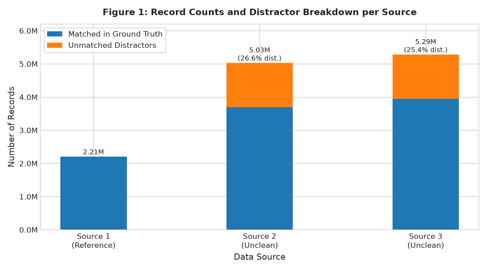
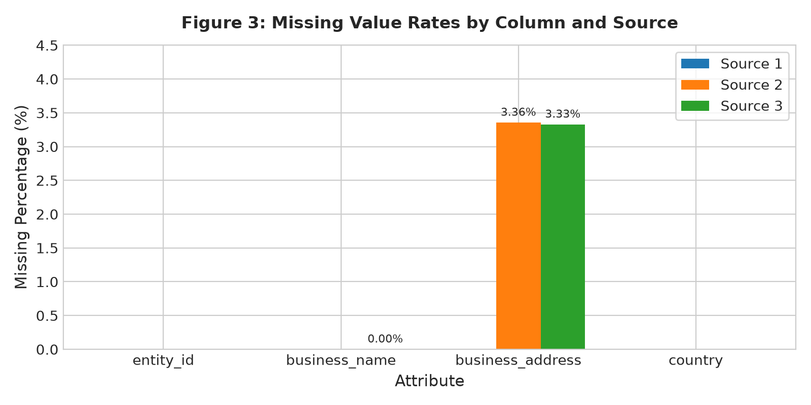
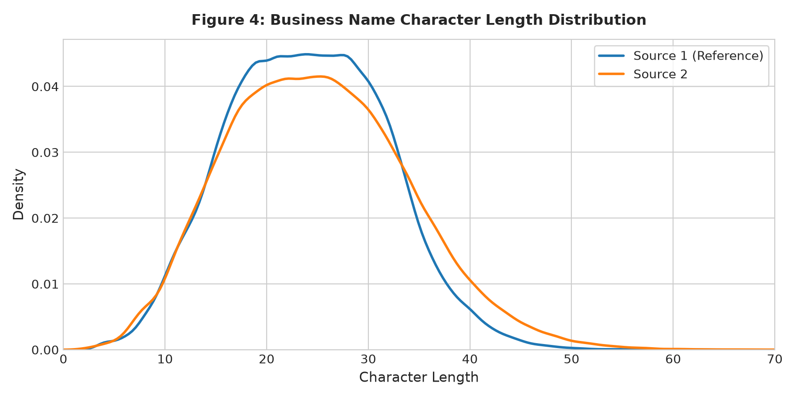
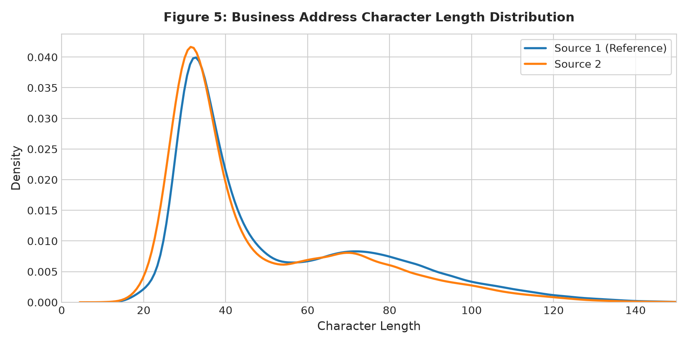
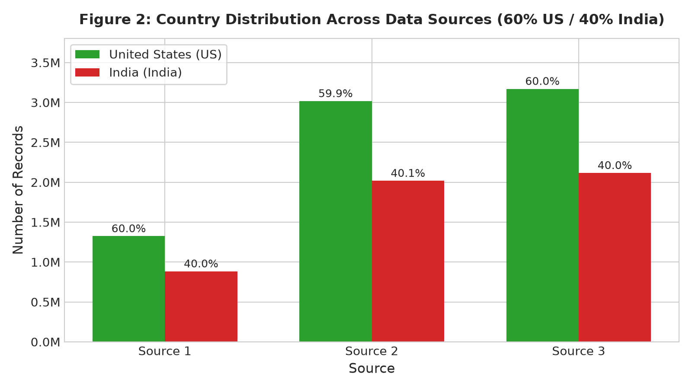
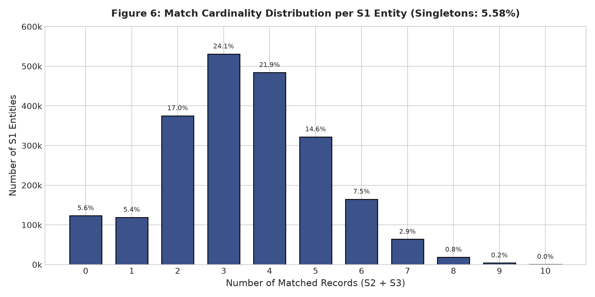
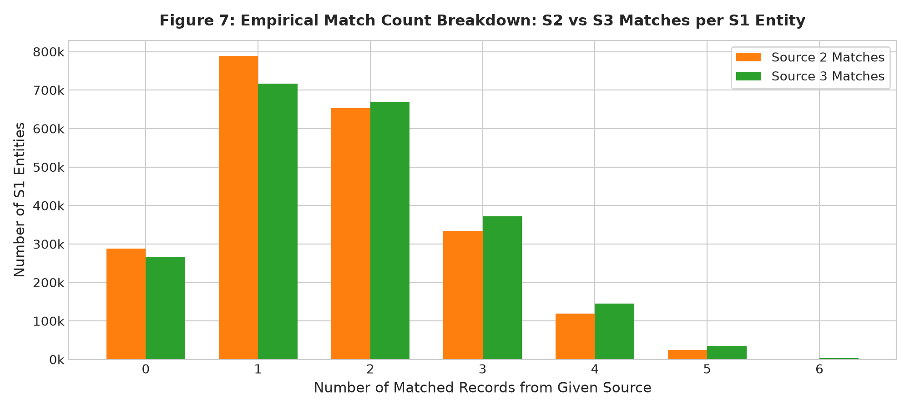
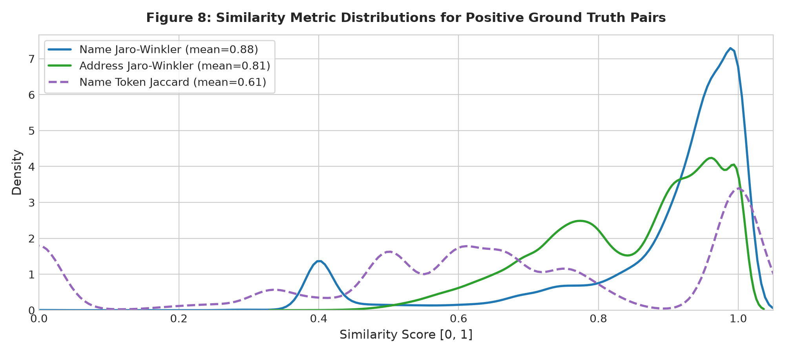
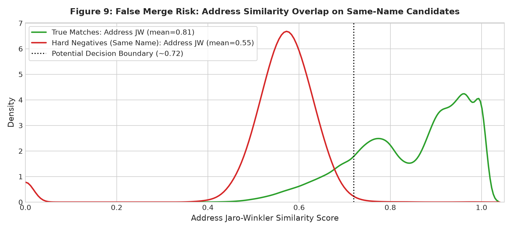

# Amazon ML Challenge 2026 — Business Entity Resolution
# Exploratory Data Analysis & Strategic Decision Report

**Target Problem:** Cross-Source Business Entity Resolution (Reference Source 1 $\rightarrow$ Sources 2 & 3)  
**Evaluation Metric:** Macro-averaged $F_{0.5}$ Score (weights Precision $2\times$ over Recall, penalizing false merges)  
**Dataset Scale:** 12,527,040 Training Records (S1: 2.21M, S2: 5.03M, S3: 5.29M) + Ground Truth (2.21M rows)  
**Date of Analysis:** September 2026  
**Pipeline Execution Command:** `python eda/run_eda.py`  

---

## 1. Executive Summary

- **Deduplicated Reference Source vs. Unclean Fragment Sources:** Source 1 functions as the authoritative, deduplicated entity catalog (2,206,821 unique entities, zero missing attributes, 0 duplicates on `(name, address)`). Sources 2 and 3 represent noisy operational fragments with 5,034,616 and 5,285,603 records respectively, each containing ~25–27% distractor records that match no S1 entity.
- **Strict 1-to-At-Most-1 Reverse Cardinality:** While an S1 entity can match multiple S2 records (up to 5, mean 1.67) and multiple S3 records (up to 6, mean 1.79), **not a single S2 or S3 entity maps to more than one S1 entity in the ground truth (0.0000%)**. An S2/S3 entity belongs strictly to at most one parent S1 entity.
- **Singleton Rate is Critical (5.58%):** 123,247 Source 1 entities have **zero matches** in the ground truth. Correctly predicting an empty match list earns a full 1.0 under macro $F_{0.5}$, while any false positive match results in an immediate 0.0 score on that entity.
- **Dominance of Multi-Matches (89.01%):** 1,964,417 S1 entities match $\ge 2$ records across S2 and S3 (modal count is 3 matches at 24.05%, followed by 4 at 21.94% and 2 at 17.00%). Blocking systems that retrieve only top-1 nearest neighbors will suffer an immediate ~89% recall deficit.
- **Address Casing and Abbreviation Asymmetry:** Source 1 enforces Title-Case formatting and expanded street types (`Road` 20.9% vs `Rd` 0.89%; `Street` 14.0% vs `St` 0.73%). In contrast, Source 2 has **65.57% fully uppercase addresses** and heavily uses abbreviations (`Rd` 6.79%, `St` 6.85%, `Ave` 4.63%, `Dr` 5.88%). Exact raw string match on address is **0.00%** between S1 and S2.
- **Cross-Lingual Transliteration in Indian Entities:** In Source 1, 100% of Indian business names are standardized in Latin/English text (0.00% Devanagari). In contrast, **13.10% of Indian entities in Source 2 and 7.51% in Source 3 feature Devanagari script** (e.g., `साउथ प्रॉपर्टीज प्राइवेट लिमिटेड` vs `South Properties Private Limited`). Blocking based purely on English token matching will fail catastrophically on these pairs unless address-based blocking or transliteration is applied.
- **Strict Country Invariance in Matches:** Across 100% of positive pairs, matched entities share the exact same country code. Country is a **strict partition block** (no candidate pair should ever cross country boundaries).
- **The "France" Test Set Challenge:** The training data contains only US (59.95%) and India (40.05%), but the test set introduces `France`. Pipelines must avoid hardcoding country lists or country-specific categorical encoders.
- **High Prevalence of Dangerous False-Merge Negatives:** Over 20,000 corporate name collisions (e.g., `Summit Inc`, `Cobalt LLC`, `Sai Enterprises` sharing identical names across completely distinct states/cities) and shared physical facilities (malls, industrial estates sharing identical addresses across different businesses) were identified. Because $F_{0.5}$ weights precision $2\times$ over recall, aggressive merging on name similarity alone will devastate leaderboard scores.
- **Validation Leakage Risk:** Random pair-level train/validation splits leak the same S1 entity across splits, causing severe data leakage and inflated validation scores. **Entity-level GroupKFold on `source1_entity_id` is mandatory**.

---

## 2. Dataset Overview

All files were parsed using tab separation (`sep="\t"`). Memory usage, dimensions, and ID conventions are summarized below.

### Primary Dataset Dimensions Table

| Dataset | File | Rows | Columns | Memory Usage | Unique Entity IDs | ID Prefix | Country Distribution |
|---|---|---:|---:|---:|---:|:---:|---|
| **Source 1** | `train_source1.tsv` | 2,206,821 | 4 | 604.4 MB | 2,206,821 | `S1-` (100%) | US: 1,323,633 (59.98%), India: 883,188 (40.02%) |
| **Source 2** | `train_source2.tsv` | 5,034,616 | 4 | 1,418.8 MB | 5,034,616 | `S2-` (100%) | US: 3,016,817 (59.92%), India: 2,017,799 (40.08%) |
| **Source 3** | `train_source3.tsv` | 5,285,603 | 4 | 1,478.5 MB | 5,285,603 | `S3-` (100%) | US: 3,170,056 (59.97%), India: 2,115,547 (40.03%) |
| **Ground Truth** | `train_ground_truth.tsv` | 2,206,821 | 2 | 321.2 MB | 2,206,821 | `S1-` (100%) | Ground Truth labels for all S1 entities |



### Key Structural Findings
1. **Total Volume:** Across training sources, there are **12,527,040 business records**.
2. **Entity ID Integrity:** Every ID strictly conforms to its expected prefix (`S1-` for Source 1, `S2-` for Source 2, `S3-` for Source 3). There are **zero duplicate IDs** within any source.
3. **Reference Deduplication:** Source 1 is strictly deduplicated: zero duplicates on `(business_name, business_address)`.
4. **Distractor Scale:** 
   - Out of 5,034,616 Source 2 records, only **3,693,619 match an S1 entity**. **1,340,997 records (26.63%) are distractors**.
   - Out of 5,285,603 Source 3 records, only **3,944,746 match an S1 entity**. **1,340,857 records (25.37%) are distractors**.
   - The matching model must be capable of rejecting candidates that resemble reference entities but are actually unlinked distractors.

---

## 3. Data Quality Analysis

### Missingness Profiling

| Field | Source 1 Missing | Source 2 Missing | Source 3 Missing | Missingness Pattern & Country Variation |
|---|---:|---:|---:|---|
| `entity_id` | 0 (0.00%) | 0 (0.00%) | 0 (0.00%) | Completely populated across all sources. |
| `business_name` | 0 (0.00%) | 2 (<0.001%) | 13 (<0.001%) | Negligible missingness. |
| `business_address` | 0 (0.00%) | **168,967 (3.36%)** | **175,916 (3.33%)** | Concentrated in both US (3.68% S2 / 3.50% S3) and India (2.87% S2 / 3.07% S3). |
| `country` | 0 (0.00%) | 0 (0.00%) | 0 (0.00%) | 100% complete across all files. |
| **Both Name & Address Missing** | **0 (0.00%)** | **0 (0.00%)** | **0 (0.00%)** | At least one textual field is always present. |



#### Implications of Missing Address
- ~3.35% of Source 2 and Source 3 records completely lack an address (`NaN`).
- In ground truth, **4.37% of true positive pairs have a missing address in S2 or S3**.
- For these entities, matching relies **exclusively on business name similarity and country**. Address-only blocking will permanently drop 4.37% of true matches.

---

### Duplicate Analysis

| Duplicate Level | Source 1 | Source 2 | Source 3 | Nature of Observed Duplication |
|---|---:|---:|---:|---|
| Duplicate `entity_id` | 0 | 0 | 0 | Unique keys are preserved. |
| Duplicate `business_name` | 667,592 | 632,607 | 633,994 | **Legitimate distinct businesses:** Chains, franchises, and common trade names (e.g., `Summit Inc`, `Subway`, `Sai Enterprises`). |
| Duplicate `business_address` | 76,215 | 697,354 | 652,838 | **Legitimate shared premises:** Multi-tenant commercial complexes, corporate parks, and shopping malls. |
| Duplicate `(name, address)` | **0** | **25,891** | **18,881** | **Duplicate operational observations:** Multiple records for the same physical entity with distinct entity IDs. |
| Duplicate `(name, address, country)` | **0** | **25,873** | **18,860** | Matches `(name, address)` duplicates almost exactly. |

#### Empirical Investigation of Duplicates:
1. **Duplicate Observations:** In Source 2, entities `S2-925640291` and `S2-162845527` both have name `# 2 CE Wellness` and address `5615 MONROE ST, HYATTSVILLE CITY, MD`. Ground truth verification confirms that **both map to the same S1 entity (`S1-540170423`)**. They represent multiple observations of the same entity ingested by Source 2.
2. **Shared Commercial Addresses:** Address `# ##17/B/5, Yelahanka, Doddaballapura Road Opp to Rail Wheel Factory, Bangalore, Karnataka` contains `Kalsi Resorts`, `Bangalore Records Pvt`, and `Top Gauging LLP`. These are distinct legal entities located at the same industrial facility. Merging based on address alone is a severe error.

---

## 4. Business Name Analysis

### Name Profiling & Noise Distribution

| Metric / Pattern | Source 1 (Reference) | Source 2 (Operational) | Source 3 (Operational) | Observed Evidence & Impact |
|---|---:|---:|---:|---|
| **Mean Character Length** | 24.0 (median: 24.0) | 25.1 (median: 25.0) | 25.2 (median: 25.0) | Extremely consistent name length across sources. |
| **Mean Token Count** | 3.5 (median: 4.0) | 3.5 (median: 4.0) | 3.5 (median: 4.0) | Names typically contain 3 to 4 tokens. |
| **All Uppercase Casing** | **0.00%** | **27.84%** | **7.61%** | Source 2 has substantial uppercase text; S1 has zero. Case normalization is required. |
| **Punctuation Frequency** | 20.92% | **42.85%** | **40.19%** | S2 and S3 have double the punctuation noise (dashes, slashes, hash symbols `#`, quotes). |
| `Ltd` vs `Limited` | 6.73% vs 23.67% | 7.92% vs 10.51% | 8.11% vs 12.74% | S1 strongly prefers expanded `Limited`; S2/S3 mix `Ltd` and `Limited`. |
| `Pvt` vs `Private` | 5.50% vs 19.59% | 3.80% vs 10.49% | 4.18% vs 12.12% | S1 strongly prefers expanded `Private`. |
| `Corp` vs `Corporation` | 1.57% vs 0.65% | 2.79% vs 1.24% | 2.65% vs 1.09% | Both abbreviations occur regularly. |
| `Inc` vs `Incorporated` | 10.80% vs 0.00% | 7.98% vs 0.52% | 8.12% vs 0.48% | S1 uses `Inc` exclusively; `Incorporated` rarely appears. |
| `&` vs `and` | 5.07% vs 2.60% | 4.15% vs 2.34% | 4.22% vs 2.30% | `&` occurs twice as often as `and` across all sources. |
| **Devanagari Script (India)** | **0.00%** | **13.10%** | **7.51%** | Major language asymmetry: S1 is purely Latinized, while S2/S3 contain native Hindi script. |



### Observed Real-World Name Noise Examples:
1. **Legal Suffix Inconsistency:**
   - S1: `Grand Connecticut LLC` $\leftrightarrow$ S2: `Grand Connecticut` (Suffix completely dropped)
   - S1: `Davis Family Office` $\leftrightarrow$ S2: `Davis Family Offie` (Typo: missing 'c')
2. **Word Order & Insertion:**
   - S1: `Prairie Capital Partners PLLC` $\leftrightarrow$ S3: `Prairie Partners PLLC Services` (Token dropped + suffix token inserted)
   - S1: `MS Consultancy Corp` $\leftrightarrow$ S3: `MS Corp Services`
3. **Cross-Script Transliteration:**
   - S1: `South Properties Private Limited` $\leftrightarrow$ S2: `साउथ प्रॉपर्टीज प्राइवेट लिमिटेड`
   - Levenshtein / Jaccard similarity is **0.000**, yet address and country are identical.

---

## 5. Address Analysis

### Address Profiling & Structural Discrepancies

| Metric / Feature | Source 1 (Reference) | Source 2 (Operational) | Source 3 (Operational) | Discrepancy & Handling |
|---|---:|---:|---:|---|
| **Mean Character Length** | 52.1 (median: 41.0) | 47.8 (median: 37.0) | 48.3 (median: 42.0) | S1 addresses are ~4–5 characters longer due to expanded street tokens. |
| **All Uppercase Casing** | **0.00%** | **65.57%** | **0.02%** | S2 addresses are overwhelmingly uppercase (`65.57%`); S1 and S3 are Title/Mixed case. |
| `Road` vs `Rd` | **20.93% vs 0.89%** | **13.71% vs 6.79%** | **12.16% vs 6.36%** | S1 expands `Road` ($23\times$ more often than `Rd`), while S2/S3 heavily abbreviate. |
| `Street` vs `St` | **14.02% vs 0.73%** | **6.92% vs 6.85%** | **6.94% vs 6.49%** | S1 expands `Street` ($19\times$ more often than `St`); S2/S3 split evenly. |
| `Avenue` vs `Ave` | **8.60% vs 0.14%** | **4.00% vs 4.63%** | **3.88% vs 4.51%** | S1 expands `Avenue` ($61\times$ more often than `Ave`). |
| `Drive` vs `Dr` | **10.04% vs 0.38%** | **4.43% vs 5.88%** | **4.32% vs 5.71%** | S1 expands `Drive` ($26\times$ more often than `Dr`). |
| **Landmarks (Near / Opp / Floor)** | 11.83% | 10.54% | 10.60% | Common in Indian addresses (e.g., `Opp. Ratna Hospital`, `Near SBI ATM`, `1st Floor`). |
| **Postal Codes (5-digit / 6-digit)** | 6.68% | 7.60% | 7.55% | US 5-digit ZIPs present in ~6.7% of raw records; Indian 6-digit PINs in ~0.8%. |



### Observed Real-World Address Noise Patterns:
1. **Component Reordering & State Abbreviations:**
   - S1: `Calumet City, 351 Hoxie Avenue, IL`
   - S2: `CALUMET CITY, 351 HOXIE AVE, N/A, IL`
   - S3: `351- Hoxie Ave, Calumet City, Illinois`
   - Observations: House number moved from middle to start; `Avenue` $\rightarrow$ `AVE` $\rightarrow$ `Ave`; `IL` $\rightarrow$ `Illinois`.
2. **Indian Localities & Landmarks:**
   - S1: `Shymala Appts 1St Floor Flat No. 4 Opp Ratna Hospital Sb Road In Haveli, Pune, Maharashtra`
   - S3: `Shymala Appts 1St Floor Flat No. 4 Opp Ratna Hospital Sb Road In Haveli, Pune, MH`
   - Observations: Landmark intact; `Maharashtra` abbreviated to state code `MH`.

---

## 6. Country Analysis & Open-Set Constraint



### Training Country Proportions
- **United States (`US`):** Exactly **59.95%** across all three training sources ($1.32\text{M}$ in S1, $3.02\text{M}$ in S2, $3.17\text{M}$ in S3).
- **India (`India`):** Exactly **40.05%** across all three training sources ($0.88\text{M}$ in S1, $2.02\text{M}$ in S2, $2.12\text{M}$ in S3).
- **Missing / Unknown Country:** **0.00%** (zero missing values across all 12.5M rows).

### Matching Difficulty Across Countries (Empirical Benchmark)
| Country | Sampled Positive Pairs | Normalized Name Match % | Mean Name Jaro-Winkler | Mean Address Jaro-Winkler | Missing Address % |
|---|---:|---:|---:|---:|---:|
| **United States** | 54,777 | 25.74% | **0.9241** | **0.8205** | 4.65% |
| **India** | 36,944 | 15.70% | **0.8125** | **0.7922** | 3.97% |

#### Critical Finding:
Entity resolution on Indian businesses is **significantly more challenging** than on US businesses:
1. Normalized exact name match rate is $39\%$ lower in India ($15.70\%$ vs $25.74\%$).
2. Name Jaro-Winkler drops from $0.924$ to $0.813$, driven by Devanagari script, phonological transliterations, and diverse honorific/legal prefixes.
3. Indian addresses rely heavily on relative landmarks (`Opp`, `Near`, `Behind`, `Phase-1`, `Sector`) rather than standardized grid numbers.

#### The Open-Set Constraint (`France` in Test Set):
The competition specification notes:
> *"The training data covers US and India. The test set additionally contains a third country, France... Treat country as an open set of string labels."*

**Rules for Pipeline Architecture:**
1. Never one-hot encode country into a fixed two-column vector `[is_US, is_India]`.
2. Never filter datasets using hardcoded `if country in ['US', 'India']`.
3. Blocking should partition by `country` dynamically: `df.groupby('country')`. This automatically groups French records together in the test set without manual intervention.

---

## 7. Ground Truth & Match Cardinality Analysis



### Cardinality Breakdown Table

| Matched Records ($k$) | Total S1 Entities | Percentage of S1 | S2 Matches Count | S2 Match % | S3 Matches Count | S3 Match % |
|---|---:|---:|---:|---:|---:|---:|
| **0 (Singletons)** | **123,247** | **5.58%** | 287,745 | 13.04% | 266,276 | 12.07% |
| **1 match** | 119,157 | 5.40% | 789,108 | 35.76% | 716,417 | 32.46% |
| **2 matches** | 375,212 | 17.00% | 652,779 | 29.58% | 668,375 | 30.29% |
| **3 matches** | **530,841** | **24.05%** | 333,957 | 15.13% | 372,443 | 16.88% |
| **4 matches** | 484,115 | 21.94% | 119,078 | 5.40% | 145,116 | 6.58% |
| **5 matches** | 321,957 | 14.59% | 24,154 | 1.09% | 35,378 | 1.60% |
| **6 matches** | 164,868 | 7.47% | 0 | 0.00% | 2,816 | 0.13% |
| **7 matches** | 63,968 | 2.90% | 0 | 0.00% | 0 | 0.00% |
| **8 matches** | 18,680 | 0.85% | 0 | 0.00% | 0 | 0.00% |
| **9 matches** | 4,205 | 0.19% | 0 | 0.00% | 0 | 0.00% |
| **10 matches** | 534 | 0.02% | 0 | 0.00% | 0 | 0.00% |
| **11 matches** | 37 | <0.01% | 0 | 0.00% | 0 | 0.00% |
| **Total** | **2,206,821** | **100.00%** | **2,206,821** | **100.00%** | **2,206,821** | **100.00%** |



### Key Empirical Cardinality Discoveries:
1. **Average Matches:** An S1 entity matches an average of **3.461 records** (1.674 from S2 and 1.788 from S3). The maximum observed matches for a single S1 entity is **11 records**.
2. **Reverse 1-to-At-Most-1 Invariance:**
   - Out of 3,693,619 matched S2 entities: **0 map to more than one S1 entity**.
   - Out of 3,944,746 matched S3 entities: **0 map to more than one S1 entity**.
   - **Architectural Implication:** If candidate generation or model prediction assigns `S2-XXXX` to `S1-A` with high confidence, that same `S2-XXXX` record should have its probability for `S1-B` suppressed. Enforcing 1-to-at-most-1 assignment post-processing (e.g., maximum weight bipartite matching or 1-to-many greedy assignment) aligns directly with ground-truth physics.
3. **Singletons (5.58%):**
   - 123,247 S1 entities have no true matches. In the competition's macro $F_{0.5}$ formula, predicting an empty list for a singleton scores **1.0**, while predicting even a single false match scores **0.0**. Setting an appropriately high confidence threshold to maintain precision on singletons is essential.

---

## 8. Positive-Pair Analysis

From 30,000 sampled S1 entities with ground truth links, **91,721 true positive pairs** were evaluated.



### Positive Pair Similarity Metrics

| Metric | Business Name | Business Address | Notes |
|---|---:|---:|---|
| **Exact Raw Equality** | 4.64% | 2.20% | Only 1 in 20 true matches has identical raw text. |
| **Normalized Equality** | 21.70% | 8.11% | Lowercase + punctuation removal bridges ~17% of name gap. |
| **Mean Jaro-Winkler** | **0.8792** | **0.8091** | High average similarity, but with a wide tail. |
| **Mean Levenshtein Sim** | 0.7185 | 0.6382 | Character-level edit distance. |
| **Mean Token Jaccard** | 0.6141 | 0.5959 | Token overlap accounts for word reordering. |
| **Country Agreement** | **100.00%** | **100.00%** | Zero cross-country positive matches. |

### Categorized Positive Match Archetypes

#### 1. Easy Matches (High Name JW > 0.95, High Address JW > 0.95)
- **S1:** `Davis Family Office` | `88 Olive Circle, Lebanon, TN`
- **S2:** `Davis Family Offie` | `88 OLIVE CIR, LEBANON, TN`
- *Observation:* Minor single-character typo (`Offie`), standard abbreviation (`CIR`), uppercase casing.

#### 2. Moderately Noisy Matches (0.75 < Name JW < 0.90, 0.70 < Address JW < 0.85)
- **S1:** `Grand Connecticut LLC` | `Calumet City, 351 Hoxie Avenue, IL`
- **S3:** `Grand Grand Connecticut LLC` | `351- Hoxie Ave, Calumet City, Illinois`
- *Observation:* Token duplication (`Grand Grand`), address component transposition, state expansion.

#### 3. Weak Name, Strong Address (Name JW < 0.70, Address JW > 0.90)
- **S1:** `MS Consultancy Corp` | `Shymala Appts 1St Floor Flat No. 4 Opp Ratna Hospital Sb Road In Haveli, Pune, Maharashtra`
- **S3:** `MS Corp Services` | `Shymala Appts 1St Floor Flat No. 4 Opp Ratna Hospital Sb Road In Haveli, Pune, MH`
- *Observation:* Corporate identity abbreviated/rebranded from `Consultancy Corp` to `Corp Services`, but landmark and address are identical.

#### 4. Strong Name, Missing Address (Name JW > 0.95, Address NaN)
- **S1:** `Cobalt Blue Technologies LLC` | `450 North Brand Boulevard, Glendale, CA`
- **S2:** `Cobalt Blue Technologies LLC` | `NaN`
- *Observation:* Occurs in 4.37% of true positive pairs. Must rely on name distinctiveness and country.

---

## 9. Hard Negative Analysis & False Merge Risk

Because macro $F_{0.5}$ weights precision $2\times$ more than recall ($1.25 \times P \times R / (0.25 \times P + R)$), **false merges are twice as costly as missed matches**.



### Two Primary Archetypes of Hard Negatives:

#### Archetype 1: Identical / Near-Identical Business Name, Different Entity
- **Frequency:** Extremely common for ubiquitous business terms, franchises, chains, and sole proprietorships.
- **Observed Examples:**
  - `S1-181497142` (`Summit Inc` in Raleigh, NC) vs `S2-163963287` (`Summit Inc` in Greensboro, NC).
  - `S1-186901093` (`Summit Inc` in Anderson, IN) vs `S2-163963287` (`Summit Inc` in Greensboro, NC).
  - `S1-1286274` (`Cobalt LLC` in Raleigh, NC) vs `S2-294835210` (`COBALT (LLC)` in Canler, NC).
- **Statistical Behavior:**
  - Name similarity is **1.000**.
  - Address Jaro-Winkler similarity averages **0.5503** (distribution overlaps with lower tail of positive matches, as shown in Figure 9).
  - If a blocking or scoring model relies solely on business name, it will merge all `Summit Inc` entities into a single entity, causing catastrophic precision collapse.

#### Archetype 2: Identical / Shared Address, Different Business Entity
- **Frequency:** Occurs at corporate centers, office parks, shopping centers, and multi-tenant buildings.
- **Observed Examples:**
  - Address: `OH, New Lexington, 209 Orchard Street`
    - S1: `Bethel & Eubanks Jpmorgan Inc` $\neq$ S2: `Bison Charlton LLC`
  - Address: `9219 Falls Creek Trail, Albuquerque, NM`
    - S1: `Taylor Harbor Senior` $\neq$ S2: `Vanguard Plant Inc`
  - Address: `C-8/8112 Vasant Kunj, New Delhi, Delhi`
    - S1: `Fg Infra Private Limited` $\neq$ S2: `साउथ प्रॉपर्टीज प्राइवेट लिमिटेड`
- **Statistical Behavior:**
  - Address similarity is **1.000**.
  - Name Jaro-Winkler similarity averages **0.5499**.
  - Models that blindly link records sharing an address will produce severe false merges.

---

## 10. Cross-Source Consistency (Source 2 vs. Source 3)

| Dimension | Source 2 | Source 3 | Comparison & Difficulty Assessment |
|---|---:|---:|---|
| **Total Rows** | 5,034,616 | 5,285,603 | S3 is 5.0% larger. |
| **Missing Address Rate** | 3.36% (168,967 rows) | 3.33% (175,916 rows) | Nearly identical address missingness. |
| **Address Uppercase %** | **65.57%** | **0.02%** | **Major structural asymmetry:** S2 is mostly uppercase; S3 is Title/Mixed case. |
| **Name Uppercase %** | **27.84%** | **7.61%** | S2 names are $3.7\times$ more likely to be uppercase. |
| **Non-ASCII in India Names** | **27.37%** | **18.49%** | S2 contains significantly more native Devanagari script and UTF-8 encoding noise. |
| **Duplicate `(name, addr)`** | 25,891 | 18,881 | S2 has 37% more duplicate observations than S3. |
| **Exact Match % to S1** | Name: 4.78%, Addr: 0.00% | Name: 4.51%, Addr: 4.26% | S2 has 0.00% exact address match due to uppercase casing. |
| **Mean Name JW to S1** | 0.8766 | 0.8815 | Comparable semantic similarity once normalized. |
| **Mean Addr JW to S1** | 0.8243 | 0.7949 | S2 address similarity is slightly higher once case is stripped. |
| **Distractor Ratio** | 26.63% | 25.37% | Both contain ~1.34M unmatchable distractor records. |

### Conclusion on Sources:
Source 2 and Source 3 exhibit **distinct noise profiles**:
- **Source 2** is characterized by legacy relational database formatting: high uppercase rates (65.6% address, 27.8% name), standard USPS-style abbreviations (`CIR`, `AVE`, `BLVD`), and high Devanagari script presence in Indian records ($27.4\%$ non-ASCII).
- **Source 3** is characterized by web-scraped formatting: Title-cased text, word duplications (`Grand Grand`), inserted service descriptors (`Services`, `Partners`), and component reordering.
- Both sources exhibit comparable matching difficulty, but require case and abbreviation normalization to align with Source 1.

---

## 11. Normalization Opportunities & Risk Assessment

Based exclusively on patterns observed in the dataset, normalization rules are classified into high-confidence candidates and potentially dangerous transformations.

### Normalization Matrix Table

| Observed Pattern | Raw Frequency | Real Dataset Example | Recommended Handling | Safety Classification |
|---|---:|---|---|:---:|
| **Case Inconsistency** | 65.6% S2 Addr, 27.8% S2 Name | `5615 MONROE ST` vs `5615 Monroe St` | Convert all names and addresses to lower-case. | **High-Confidence (Safe)** |
| **Excess Whitespace / Punctuation** | 42.8% S2 Names, 100% Addrs | `# ##1063 , URBAN ESTATE` | Strip leading `#`, collapse repeated punctuation, strip punctuation around legal terms. | **High-Confidence (Safe)** |
| **Ampersand Invariance** | 5.07% S1, 4.15% S2 | `Bethel & Eubanks` vs `Bethel and Eubanks` | Replace all `&` with `and`. | **High-Confidence (Safe)** |
| **Standard US Street Types** | 10–20% of addresses | `Road` $\leftrightarrow$ `Rd`, `Street` $\leftrightarrow$ `St`, `Avenue` $\leftrightarrow$ `Ave` | Normalize standard abbreviations to expanded form or uniform abbreviation. | **High-Confidence (Safe)** |
| **Common Legal Suffixes** | 10–25% of names | `Limited` $\leftrightarrow$ `Ltd`, `Private` $\leftrightarrow$ `Pvt`, `Corp` $\leftrightarrow$ `Corporation` | Normalize to canonical tokens (`ltd`, `pvt`, `corp`, `inc`, `llc`) for similarity computation. | **High-Confidence (Safe)** |
| **Indian Administrative Terms** | ~10% of India Addrs | `Opp.` $\leftrightarrow$ `Opposite`, `Flr` $\leftrightarrow$ `Floor`, `Nr` $\leftrightarrow$ `Near` | Expand/standardize landmark prepositions. | **High-Confidence (Safe)** |
| **Complete Suffix Stripping** | N/A | `Summit Inc` $\rightarrow$ `Summit` | **DO NOT strip completely:** In generic names (`Summit`, `Cobalt`, `Apex`), `Inc` vs `LLC` vs `Bank` may be the only differentiator. Compute features both with and without suffix. | **Potentially Dangerous** |
| **Aggressive Number Removal** | N/A | `# 2 CE Wellness` $\rightarrow$ `CE Wellness` | **DO NOT remove numbers:** Addresses depend on building/flat numbers (`351 Hoxie`, `Flat 101`). Many business names contain distinctive numbers (`7-Eleven`, `3M`, `# 2`). | **Potentially Dangerous** |
| **Blind Stopword Removal** | N/A | `First National Bank` $\rightarrow$ `National` | Stripping common business terms (`Bank`, `Services`, `Holdings`) destroys critical semantic distinction. | **Potentially Dangerous** |

---

## 12. Validation Strategy Recommendations

### 1. Mandatory Entity-Level Grouping (Leakage Prevention)
- **The Risk:** In Source 2 and Source 3, multiple records belong to the same S1 entity (up to 5 and 6 records respectively). If individual candidate pairs are split randomly into train and validation folds, records matching the same S1 entity will appear in both splits. The model will overfit to specific entity names and addresses, producing artificially high validation scores that fail to generalize.
- **The Requirement:** **GroupKFold cross-validation grouped strictly on `source1_entity_id`**. Every record belonging to an S1 entity must be contained entirely within the train fold or the validation fold.

### 2. Validation Metric Alignment
- The validation score must implement the exact competition metric:
  $$F_{0.5} = \frac{1.25 \times \text{Precision} \times \text{Recall}}{0.25 \times \text{Precision} + \text{Recall}}$$
- Calculated **per Source 1 entity**, then **macro-averaged across all S1 entities** in the validation fold.
- **Include Singletons in Validation:** Validation folds must include the 5.58% singleton entities. Correctly predicting an empty match list earns a 1.0; predicting an erroneous candidate earns a 0.0.

### 3. Stratified Country Splitting
- Because the test set introduces `France`, validation models should test out-of-domain generalization. A dedicated split holding out Indian entities (training on US, evaluating on India) can verify whether learned matching thresholds transfer across geographic boundaries.

---

## 13. Implications for Pipeline Architecture

```
                             [ Raw Input TSVs ]
                                      │
                                      ▼
                        [ Text Normalization Layer ]
             (Lowercasing, Suffix Harmonization, Street Type Expansion)
                                      │
                                      ▼
                      [ Country-Strict Candidate Blocking ]
          ┌───────────────────────────┴───────────────────────────┐
          ▼                                                       ▼
[ Primary Name Blocking ]                              [ Fallback Address Blocking ]
 (Token Inverted Index / TF-IDF)                        (Locality + Number Tokens)
  * Handles Name Noise                                   * Crucial for 13% Devanagari Names
          └───────────────────────────┬───────────────────────────┘
                                      │
                                      ▼
                         [ Candidate Union & Pruning ]
                         (Target: 20–50 candidates/S1)
                                      │
                                      ▼
                       [ Feature Engineering Pipeline ]
          (Jaro-Winkler, Levenshtein, Jaccard, Numeric Discrepancy,
           Missing Address Flags, Length Ratios, Script Mismatch)
                                      │
                                      ▼
                          [ Precision-Heavy Scorer ]
                     (LightGBM / CatBoost tuned for F0.5)
                                      │
                                      ▼
                  [ Reverse 1-to-At-Most-1 Assignment Filter ]
             (Ensures no S2 or S3 entity is assigned to multiple S1s)
                                      │
                                      ▼
                           [ Final Submission TSV ]
```

### Implications for Blocking (Candidate Generation)
1. **Recall Ceiling Target:** The ground truth contains an average of 3.46 true matches per S1 entity and up to 11. Blocking that retrieves only 1 or 2 candidates per S1 will truncate the recall ceiling. A candidate pool of **20 to 50 candidates per S1 entity** is recommended.
2. **Multi-Channel Blocking is Non-Negotiable:**
   - Channel A (Name-based): Inverted token index / character n-gram TF-IDF. Catches the 95.6% of pairs with English names.
   - Channel B (Address-based): Locality / building number / street token index. Catches the 13.1% of Indian pairs where S1 is English and S2 is Devanagari.
   - Channel C (Strict Country Filter): Reject all cross-country pairs upfront (100% precision filter).

### Implications for Feature Engineering
1. **Multi-Field Similarity Measures:**
   - Jaro-Winkler similarity on normalized name and address.
   - Token-level Jaccard and containment scores (handles token reordering).
   - Character n-gram overlap (robust to internal typos like `Offie` vs `Office`).
2. **Discrepancy and Penalty Features:**
   - Numeric token mismatch (if S1 has `1510` and S2 has `1916`, penalize heavily).
   - Address missing indicator (`is_s2_addr_nan`).
   - Script mismatch indicator (`has_devanagari_s2`).
   - Length difference ratios.

---

## 14. Recommended Next Steps

Based on the quantitative evidence from this EDA, the following sequential steps are recommended for the implementation phase:

1. **Implement Robust Preprocessing Module:**
   - Lowercase all textual fields.
   - Standardize ampersands (`&` $\rightarrow$ `and`).
   - Build a dictionary of safe legal suffixes (`ltd`, `pvt`, `corp`, `inc`, `llc`) and street abbreviations (`rd`, `st`, `ave`, `dr`, `blvd`).
2. **Design a Dual-Channel Blocking Engine:**
   - Channel 1: Inverted index on 3-gram character shingles and significant tokens for business names.
   - Channel 2: City / Postal / Locality token index for address-based candidate generation to capture Devanagari Indian entities.
   - Partition candidate generation strictly by `country`.
3. **Build the Leak-Free Validation Suite:**
   - Construct a 5-fold `GroupKFold` cross-validation split based on `source1_entity_id`.
   - Implement the exact macro-averaged $F_{0.5}$ evaluation script matching `utils/validate_submission.py`.
4. **Develop Candidate Pair Feature Extractor:**
   - Extract string similarity features (Jaro-Winkler, Levenshtein, Jaccard, Token Overlap).
   - Extract numeric discrepancy features (house numbers, postal codes).
   - Add structural indicators (missing address flag, script mismatch flag).
5. **Enforce Post-Processing Cardinality Constraints:**
   - Apply a reverse 1-to-at-most-1 constraint: if an S2 or S3 entity is selected as a match for S1 entity $A$ with higher confidence, prevent it from being assigned to S1 entity $B$.
   - Tune classification thresholds strictly for $F_{0.5}$ (precision optimization).
